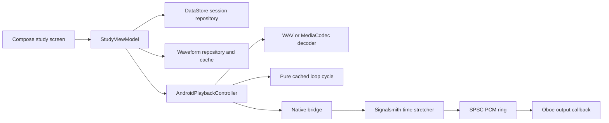

# Playback ownership and test boundaries

Loopo keeps local-file study state in Kotlin and real-time audio output in C++. The baseline for release hardening is commit `ee71995`, which the owner tested on a Xiaomi phone. That device report establishes a useful behavior reference, not a cross-device compatibility guarantee.

`StudyViewModel` owns the selected track, cancellation of obsolete opens, waveform jobs, viewport, and session saving. `AndroidPlaybackController` owns decoder and native-handle lifetime, command serialization, audio focus, seek generation, stretch priming, and the active loop cache. These owners remain separate. The UI receives state and callbacks, so its rendering tests do not require opening an audio stream.

Decoding and DSP happen before the output ring. The Oboe callback reads prepared PCM, converts channel layout, tracks source frames, and supplies silence on underrun. It must not decode, allocate, wait for a coroutine, or access storage.

The cached loop is a deterministic value containing prepared PCM and the mapping between source position and cycle phase. It retains the full source head for an initial seek, mixes the tail with the head, and wraps later cycles past the already-overlapped head. Its cursor keeps the DSP input position separate from the audible output position. Priming advances input while the first output metadata stays at the requested frame. JVM tests verify those samples and positions across multiple wraps. Platform-specific decoder reads and native writes stay with the controller. A pure cycle test cannot prove Android focus or output-device recovery.

The waveform cache identifies source content separately from the short-loop PCM cache. Comparing a full `LoopRegion` already invalidates the loop cache when markers or crossfade change. Hashing only the endpoints of a source file does not detect all waveform changes, even when size and modification time are unchanged.

Two designs were compared for this hardening pass. The selected design extracts deterministic loop logic and tests the existing storage and UI boundaries. The alternative injects decoder, native-output, focus, inspector, and clock ports into the controller and view model. That alternative enables more deterministic orchestration tests but adds a large protocol and fake implementation. Keep it available for a later change justified by uncovered controller behavior, rather than moving all responsibilities before the first release.

The design review used the configured `gpt-6-luna` model for both alternatives and the independent judge. It therefore provides independent reads, not model diversity. The judge selected the smaller loop seam and retained the alternative's Android integration test scenarios.

Remaining architectural risk is concentrated in the large controller and view model. See [Testing](testing.md) for uncovered platform behavior and [release readiness](release-readiness.md) for the gates that prevent declaring the first public release ready prematurely.
