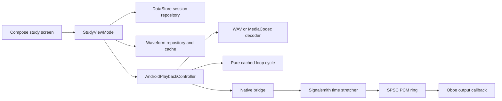

# Playback ownership and test boundaries

Loopo keeps local-file study state in Kotlin and real-time audio output in C++. The baseline for release hardening is commit `ee71995`, which the owner tested on a Xiaomi phone. That device report establishes a useful behavior reference, not a cross-device compatibility guarantee.

`StudyViewModel` owns the selected track, cancellation of obsolete opens, waveform jobs, viewport, and session saving. `AndroidPlaybackController` owns decoder and native-handle lifetime, command serialization, audio focus, seek generation, stretch priming, and the active loop cache. These owners remain separate. The UI receives state and callbacks, so its rendering tests do not require opening an audio stream.

Decoding and DSP happen before the output ring. The Oboe callback reads prepared PCM, converts channel layout, tracks source frames, and supplies silence on underrun. It must not decode, allocate, wait for a coroutine, or access storage.

The cached loop is a deterministic value containing prepared PCM and the mapping between source position and cycle phase. It retains the full source head for an initial seek, mixes the tail with the head, and wraps later cycles past the already-overlapped head. Its cursor keeps the DSP input position separate from the audible output position. Priming advances input while the first output metadata stays at the requested frame. JVM tests verify those samples and positions across multiple wraps. Platform-specific decoder reads and native writes stay with the controller. A pure cycle test cannot prove Android focus or output-device recovery.

Frame budgets use integer percent units. Each input frame contributes 100 units, and each output frame consumes the selected playback percentage. `PlaybackFrameBudgetCalculator` computes output counts and the controller-owned remainder without floating-point rounding. Native `write` returns accepted input frames; a valid call can consume input through Signalsmith while producing zero output. `TimeStretcher::process` reports acceptance separately from the requested output count.

`SourceFrameMapper` retains only the source spans not yet represented by output. It uses the same integer units, preserves each span's source anchor and loop bounds, and resolves source positions before the ring receives PCM. Three fixed span slots include the incoming span; less than two source frames can remain pending at the supported rates. This preserves the first source position after a fractional delay and the jump past an overlapped crossfade head. The callback reads prepared samples and positions. A native write checks capacity and plans mapping before DSP changes; it commits mapping only after all output is queued.

Seek and rate changes stop and join the producer before resetting DSP and publishing the new rate, remainder, and source position. A successful paused seek starts a fresh producer to prebuffer. This uses the same stop/reset/restart ownership as loop edits. Native finish uses the same integer budget and resolves the remaining DSP output. Kotlin PCM coalescing was rejected because it would add another sample buffer and lifecycle owner to the controller.

The renderer reports a consumed-frame cursor, which can equal the loop's exclusive B boundary. `LoopRegion.normalizePlaybackPosition` translates it to the active audible cycle, wrapping B to A plus the effective crossfade. The controller uses this policy when it reads position for monitoring, pause, rate changes, and loop edits. Initial positions inside the loop head remain valid, and disabled loops keep their linear cursor. This keeps loop policy outside the output callback.

The waveform cache identifies source content separately from the short-loop PCM cache. Comparing a full `LoopRegion` already invalidates the loop cache when markers or crossfade change. Hashing only the endpoints of a source file does not detect all waveform changes, even when size and modification time are unchanged.

Two designs were compared for this hardening pass. The selected design extracts deterministic loop logic and tests the existing storage and UI boundaries. The alternative injects decoder, native-output, focus, inspector, and clock ports into the controller and view model. That alternative enables more deterministic orchestration tests but adds a large protocol and fake implementation. Keep it available for a later change justified by uncovered controller behavior, rather than moving all responsibilities before the first release.

The design review used the configured `gpt-6-luna` model for both alternatives and the independent judge. It therefore provides independent reads, not model diversity. The judge selected the smaller loop seam and retained the alternative's Android integration test scenarios.

Remaining architectural risk is concentrated in the large controller and view model. See [Testing](testing.md) for uncovered platform behavior and [release readiness](release-readiness.md) for the gates that prevent declaring the first public release ready prematurely.
